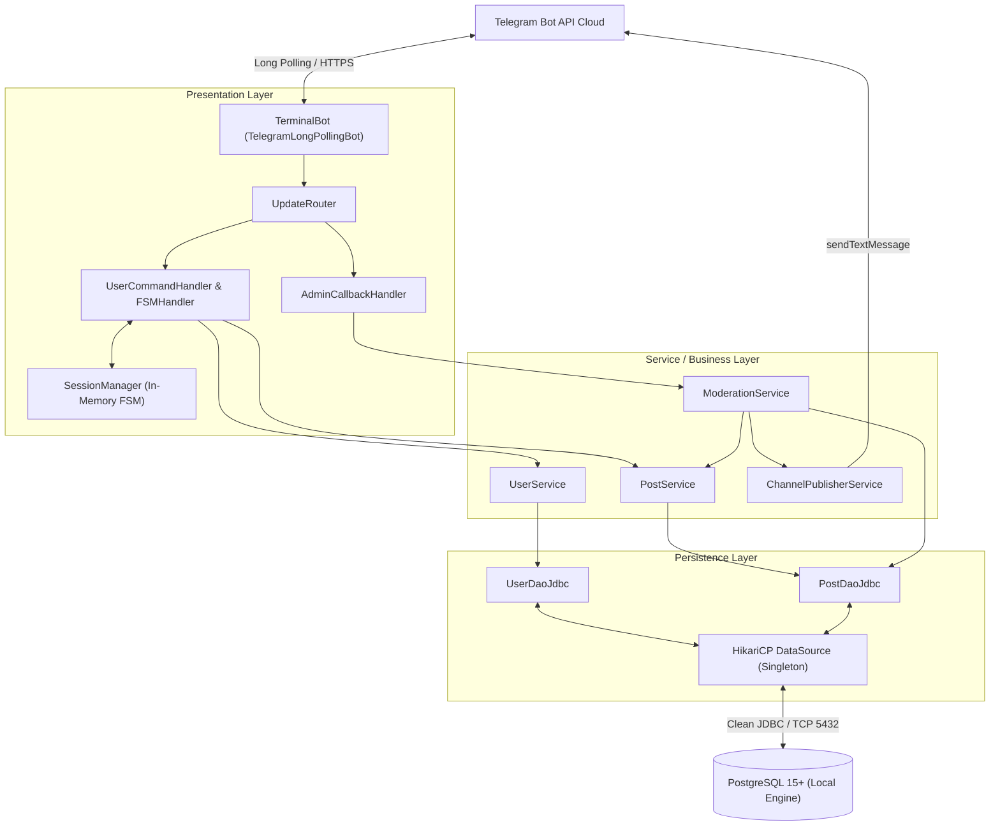
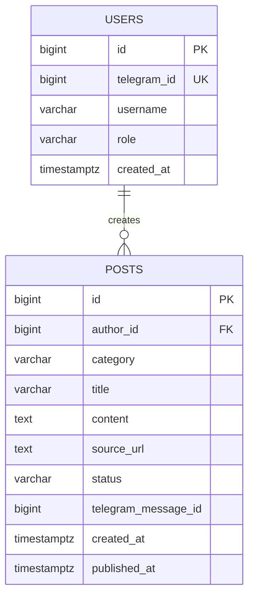
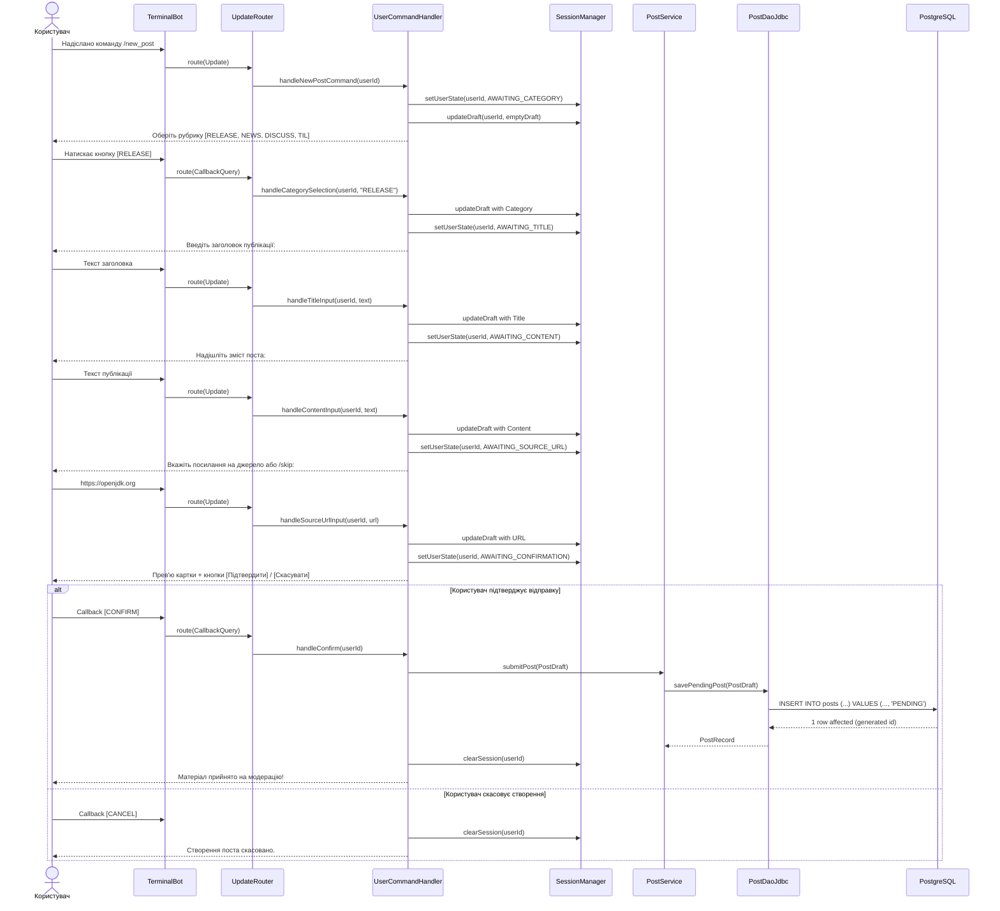
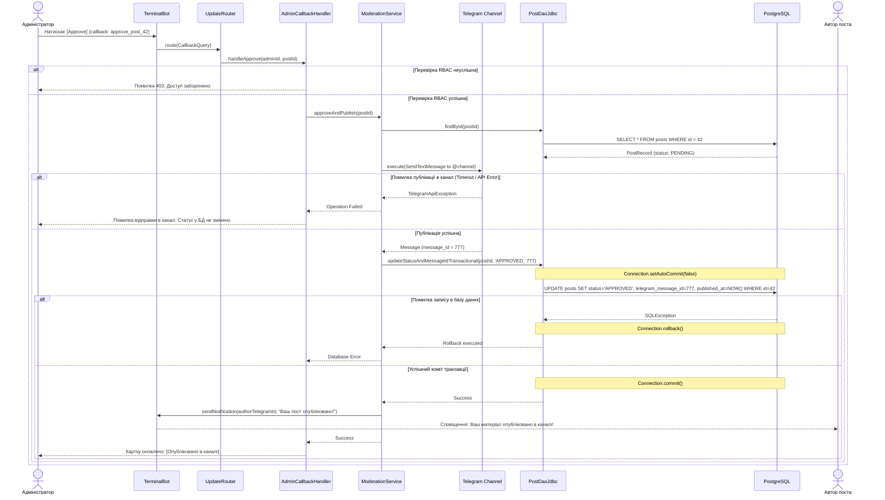

# SDD: The Terminal

## 1. Огляд і глосарій

The Terminal — це асинхронний хаб технічного контенту та IT-новин для розробників, побудований як двоконтурна архітектурна система на базі одного Telegram-бота з рольовим розмежуванням доступу (RBAC: USER та ADMIN) та одного публічного Telegram-каналу. Користувачі покроково формують структуровані публікації у фіксованих технічних рубриках через машину скінченних станів (FSM), після чого матеріали зберігаються в локальній базі даних PostgreSQL 15+ за допомогою чистого JDBC з пулом з'єднань HikariCP та проходять інлайн-модерацію адміністратором для публікації в канал. Застосунок реалізовано на платформі Java 21 без застосування сторонніх високорівневих фреймворків (таких як Spring).

**Поза скоупом першої версії:** Веб-інтерфейс на базі сервлетів чи JSP, повнотекстовий пошук контенту (Elasticsearch/pg_trgm), інтерактивні реакції під постами в каналі, коментування безпосередньо через інтерфейс бота, контейнеризація в Docker на стадії підготовки до екзамену.

**Глосарій:**

| Термін | Значення в цьому документі |
|--------|----------------------------|
| FSM (Finite State Machine) | Машина скінченних станів; механізм покрокового збереження стану діалогу користувача в оперативній пам'яті під час формування публікації. |
| PostDraft | Тимчасовий об'єкт-чернетка в пам'яті бекенду, куди записуються проміжні поля автора до моменту фінального підтвердження. |
| RBAC | Role-Based Access Control; механізм розмежування доступних команд та інтерфейсів на основі унікального Telegram ID (ролі USER та ADMIN). |
| Long Polling | Метод взаємодії з Telegram Bot API, за якого бекенд самостійно циклічно опитує сервери Telegram на наявність нових подій (`Update`). |
| Публічний канал | Окремий цільовий Telegram-канал, куди бот-адміністратор автоматично транслює остаточно схвалені записи. |
| HikariCP | Високопродуктивний пул з'єднань із базою даних на рівні JDBC. |

## 2. Функціональні вимоги

| ID | User story | Пріоритет |
|----|------------|-----------|
| US-1 | Як **користувач**, я хочу надіслати команду `/start`, щоб зареєструватися в системі та отримати доступ до створення постів. | Must |
| US-2 | Як **користувач**, я хочу за допомогою команди `/new_post` покроково ввести категорію, заголовок, зміст та URL, щоб сформувати структуровану заявку. | Must |
| US-3 | Як **користувач**, я хочу переглянути прев'ю сформованої картки перед відправкою, щоб підтвердити або скасувати публікацію. | Must |
| US-4 | Як **адміністратор**, я хочу отримувати картку нової заявки в особистий чат із кнопками `[Approve]` та `[Reject]`, щоб моделювати вхідний потік контенту. | Must |
| US-5 | Як **адміністратор**, я хочу при натисканні `[Approve]` автоматично опублікувати пост у канал із транзакційним збереженням `telegram_message_id` у БД, щоб зафіксувати факт виходу матеріалу. | Must |
| US-6 | Як **користувач**, я хочу отримати сповіщення від бота, коли мою публікацію буде схвалено або відхилено адміністратором, щоб знати статус заявки. | Should |
| US-7 | Як **користувач**, я хочу надіслати команду `/cancel` на будь-якому кроці введення, щоб очистити чернетку та вийти з режиму створення. | Should |
| US-8 | Як **користувач**, я хочу викликати команду `/my_posts`, щоб бачити історію власних публікацій та їхні поточні статуси. | Could |
| US-9 | Як **читач каналу**, я хочу натискати інлайн-кнопки реакцій під опублікованим постом, щоб оцінити корисність матеріалу. | Won't (this time) |
| US-10 | Як **адміністратор**, я хочу вказувати текстову причину відхилення поста для автора, щоб надати детальний зворотний зв'язок. | Won't (this time) |

## 3. Нефункціональні вимоги

| ID | Категорія | Вимога (з метрикою) |
|----|-----------|---------------------|
| NFR-1 | Продуктивність | Час обробки вхідного повідомлення від Telegram до відправки відповіді користувачу не перевищує 350 мс (p95) при роботі з локальною БД. |
| NFR-2 | Надійність пулу | Час отримання з'єднання з HikariCP (`connectionTimeout`) ≤ 2000 мс; відсутність витоків з'єднань завдяки суворому використанню `try-with-resources`. |
| NFR-3 | Цілісність даних | Модерація публікації виконується строго в транзакційному блоці: зміна статусу на `APPROVED` у БД скасовується (`rollback`), якщо відправка в Telegram-канал зазнала збою. |
| NFR-4 | Безпека (RBAC) | Дії модерації (обробка `approve_*` та `reject_*` callback) захищені обов'язковою верифікацією Telegram ID користувача відносно `ADMIN_TELEGRAM_ID`. |
| NFR-5 | Сумісність стеку | Додаток успішно компілюється та запускається на OpenJDK 21 (preview-фічі вимкнено) з підключенням до екземпляра PostgreSQL 15+. |
| NFR-6 | Масштаб сесій | Збереження FSM-сесій у пам'яті через `ConcurrentHashMap` стабільно витримує щонайменше 500 одночасних незавершених чернеток без росту Heap-пам'яті понад 64 MB. |

## 4. Архітектура

Архітектура реалізована за класичним 4-шаровим модульним принципом (Handler -> Service -> DAO -> Model) без використання сторонніх IoC/DI контейнерів.

**Компоненти:**

- **TerminalBot & UpdateRouter** — точка входу додатку: приймає об'єкти `Update` від Telegram API, перевіряє роль користувача та скеровує запит до відповідного обробника.
- **SessionManager** — потокобезпечний менеджер станів (FSM) на базі `ConcurrentHashMap`, що зберігає та мутує об'єкти `PostDraft` у пам'яті під час діалогу.
- **UserCommandHandler & AdminCallbackHandler** — компоненти презентаційного шару: формують меню, інлайн-клавіатури, текстові повідомлення та валідують вхідні рядки.
- **ModerationService & PostService** — шар бізнес-логіки: містить алгоритми перевірки коректності публікацій, виклику транзакційних операцій та нотифікації учасників.
- **ChannelPublisherService** — ізольований клієнт взаємодії з Telegram API для публікації затвердженого контенту в публічний канал.
- **UserDaoJdbc & PostDaoJdbc** — рівень доступу до даних: виконує параметризовані SQL-запити через чистий JDBC з використанням `PreparedStatement`.
- **HikariCP DataSource** — централізований синглтон-постачальник фізичних з'єднань пулу до локального інстансу PostgreSQL.

## 5. Модель даних

Категорії та статуси публікацій зафіксовані безпосередньо в реляційній схемі через перевірочні обмеження `CHECK` замість винесення в окремі таблиці, що оптимізує швидкість вибірок у чистому JDBC та спрощує транзакційну підтримку цілісності без зайвих `JOIN`.

## 6. Ключові сценарії

### 6.1. Покрокове створення публікації користувачем (FSM Flow)

Сценарій демонструє проходження користувачем кроків майстра створення чернетки із збереженням результату в БД зі статусом `PENDING` або скасуванням операції.

### 6.2. Транзакційна модерація та публікація в канал

Сценарій описує обробку схвалення заявки адміністратором із забезпеченням атомарності змін у разі мережевого збою взаємодії з Telegram API.

## 7. Ескіз API

Взаємодія із системою здійснюється через протокол Telegram Bot API у формі команд, текстових повідомлень у межах FSM та Callback-запитів інлайн-клавіатур.

| Метод / Тип | Команда / Callback | Призначення | Доступ |
|-------------|--------------------|-------------|--------|
| Message | `/start` | Реєстрація користувача в таблиці `users` та показ вітання. | Будь-який користувач |
| Message | `/new_post` | Ініціалізація машини станів (FSM) створення нової публікації. | USER, ADMIN |
| Message | `/cancel` | Скидання активного кроку FSM та очищення сесії з пам'яті. | USER, ADMIN |
| Message | Текстове введення | Передача заголовка/тексту/URL відповідно до поточного `UserState`. | USER, ADMIN |
| CallbackQuery | `category_<CODE>` | Фіксація рубрики (`RELEASE`, `NEWS`, `DISCUSS`, `TIL`). | USER, ADMIN |
| CallbackQuery | `post_confirm` | Фінальне підтвердження та переведення чернетки в статус `PENDING`. | USER, ADMIN |
| CallbackQuery | `post_cancel` | Відхилення чернетки на етапі попереднього перегляду. | USER, ADMIN |
| CallbackQuery | `approve_post_<id>` | Публікація в канал і транзакційне переведення в `APPROVED`. | Тільки ADMIN |
| CallbackQuery | `reject_post_<id>` | Оновлення статусу поста на `REJECTED` та нотифікація автора. | Тільки ADMIN |

## 8. Ризики та альтернативи

**Ризики:**

| Ризик | Імовірність | Вплив | Як пом'якшуємо |
|-------|-------------|-------|----------------|
| Втрата сесій FSM при перезапуску додатку | Середня | Низька | Чернетки знаходяться в пам'яті лише кілька хвилин; при втраті бот надсилає зрозуміле прохання повторити `/new_post`. |
| Збій мережі під час відправки поста в Telegram-канал при модерації | Середня | Висока | Виклик Telegram API виконується до відкриття транзакції оновлення статусу; при збої статус у БД залишається `PENDING`. |
| Вичерпання пулу з'єднань HikariCP через незакриті з'єднання | Середня | Критичний | Використання виключно конструкцій `try-with-resources` для `Connection`, `PreparedStatement` та `ResultSet`; встановлення `leakDetectionThreshold = 2000`. |
| Перевищення максимального ліміту довжини тексту Telegram (4096 символів) | Висока | Середня | Валідація довжини рядків на етапі FSM: заголовок ≤ 120 символів, тіло матеріалу ≤ 3000 символів. |

**Розглянуті альтернативи:**

- **Spring Boot + Spring Data JPA замість чистої Java 21 / JDBC:** Відкинуто, оскільки мета проєкту — фундаментальне опанування багатопоточності, керування життєвим циклом з'єднань через HikariCP та явного управління транзакціями без фреймворків.
- **Web-інтерфейс (JSP / Servlets) замість клієнта Telegram:** Відкинуто через застарілість технології JSP, непродуктивні витрати часу на верстку HTML/CSS та вищу практичну цінність асинхронного бота для сучасного портфоліо.
- **Зберігання проміжних кроків FSM у PostgreSQL замість `ConcurrentHashMap`:** Відкинуто на етапі MVP, щоб уникнути зайвого навантаження на диск через постійні операції запису та видалення короткоживучих сесій.