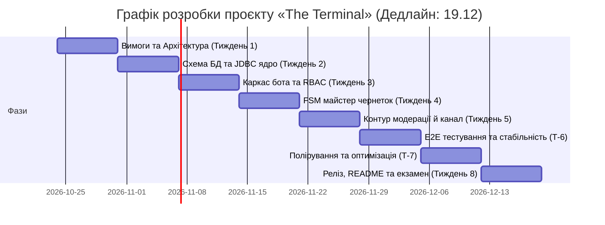

# SDLC: The Terminal

## 1. Ідея продукту

The Terminal — це асинхронний хаб технічного контенту та IT-новин для розробників, побудований як двоконтурна архітектурна система на базі одного Telegram-бота з рольовим розмежуванням доступу (RBAC: USER та ADMIN) та одного публічного Telegram-каналу. Користувачі надсилають технічні публікації та теми для обговорення через покроковий майстер FSM, після чого матеріали проходять премодерацію адміністратором через інлайн-інтерфейс в особистому чаті та транслюються в канал. Проєкт реалізується на чистій Java 21 із прямим доступом до PostgreSQL 15+ через чистий JDBC та пул HikariCP без застосування високорівневих фреймворків.

**Цільова аудиторія:** Java-розробники, DevOps-інженери, студенти технічних спеціальностей та IT-ентузіасти, яким необхідне структуроване джерело новин і релізів без інформаційного шуму.

**Біль, який розв'язуємо:** Захаращеність профільних чатів неструктурованим флудом, перевантаженість традиційних блогів лонгрідами та відсутність зручного інструменту швидкої подачі короткої структурованої замітки з гарантованою перевіркою якості.

## 2. Обрана методологія

**Методологія:** Kanban (з фіксованими тижневими контрольними точками).

**Чому саме вона для цього продукту:**
Проєкт розробляється одним інженером в умовах суворо лімітованого щоденного бюджету (~1 година на день, сумарно 6–7 годин на тиждень) із кінцевим дедлайном здачі екзамену до 19 грудня. Kanban мінімізує часові втрати на бюрократичні оцінки, концентрує зусилля на обмеженні незавершеної роботи (WIP Limit = 1–2 активні задачі) та забезпечує безперервну розробку робочого інкременту.

**Чому не інші:**

- **Waterfall:** Не підходить через негнучкість графіку та неможливість передбачити точні витрати часу на налагодження мережевих викликів Telegram API та багатопотокового JDBC, що створює ризик зриву фінального дедлайну.
- **Scrum:** Недоцільний для сольного проєкту, оскільки стандартні командні церемонії (планування, демо, ретроспективи) не створюють доданої вартості для одного розробника і забирають до 20% обмеженого часового бюджету.

## 3. Фази життєвого циклу

### 3.1. Requirements (Вимоги)

| | |
|---|---|
| **Вхідні артефакти** | Навчальні вимоги до екзаменаційного проєкту, опис концепції хабу «The Terminal». |
| **Дії** | Декомпозиція функціоналу на User Stories, фіксація рубрик ([RELEASE], [NEWS], [DISCUSS], [TIL]), визначення ролей USER та ADMIN. |
| **Вихідні артефакти** | Специфікація вимог, перелік сценаріїв FSM, пріоритезований беклог за системою MoSCoW. |
| **Критерії виходу** | Документ SDD (розділи 1–3) затверджено, обсяг MVP зафіксовано, дедлайн 19.12 погоджено. |

### 3.2. Design (Проєктування)

| | |
|---|---|
| **Вхідні артефакти** | Узгоджені функціональні та нефункціональні вимоги. |
| **Дії** | Проєктування реляційної схеми PostgreSQL (DDL), вибір параметрів пулу з'єднань HikariCP, опис станів `UserState`, розробка структури чистої 4-шарової архітектури без Spring. |
| **Вихідні артефакти** | Документ SDD (розділи 4–8), робочий SQL DDL-скрипт, діаграми потоків Mermaid. |
| **Критерії виходу** | DDL-скрипт валідовано та успішно виконано в локальній базі PostgreSQL 15+. |

### 3.3. Implementation (Розробка)

| | |
|---|---|
| **Вхідні артефакти** | Затверджений SDD, DDL-скрипти, каркас Maven-проєкту. |
| **Дії** | Налаштування HikariCP DataSource, реалізація сутностей (`records`), написання DAO на чистому JDBC, розробка FSM у Telegram-боті та контуру модерації. |
| **Вихідні артефакти** | Вихідний код проєкту на Java 21, файл змінних середовища `.env.example`. |
| **Критерії виходу** | Проєкт успішно компілюється командою `mvn clean compile`, бот запускається та встановлює з'єднання з Telegram API та базою даних. |

### 3.4. Testing (Тестування)

| | |
|---|---|
| **Вхідні артефакти** | Скомпільований білд додатка, локально запущена БД PostgreSQL. |
| **Дії** | Модульне тестування бізнес-правил валідації, інтеграційна перевірка методів DAO з верифікацією транзакційного rollback, наскрізне тестування ланцюжка публікації. |
| **Вихідні артефакти** | Набір автоматизованих тестів, чек-лист пройдених тестових сценаріїв. |
| **Критерії виходу** | Усі Must-have сценарії проходять без помилок, з'єднання з HikariCP повертаються в пул без витоків. |

### 3.5. Deployment (Розгортання)

| | |
|---|---|
| **Вхідні артефакти** | Стабільна кодова база в Git, зібраний JAR-файл, SQL-скрипти схеми. |
| **Дії** | Ініціалізація локальної БД PostgreSQL на робочій станції, заповнення файлу `.env`, призначення бота адміністратором у Telegram-каналі, запуск процесу. |
| **Вихідні артефакти** | Працюючий процес Java-додатка, підключений тестовий Telegram-канал із публікаціями. |
| **Критерії виходу** | Бот безперервно функціонує в режимі Long Polling понад 1 годину без аварійних зупинок. |

### 3.6. Maintenance (Підтримка)

| | |
|---|---|
| **Вхідні артефакти** | Працюючий бекенд, повний файл `README.md` з інструкцією запуску. |
| **Дії** | Моніторинг системних логів (Logback/SLF4J), контроль лімітів пулу HikariCP, оперативне усунення зауважень екзаменатора. |
| **Вихідні артефакти** | Фінальний стабільний релізний тег у Git (`v1.0.0-exam-release`), оновлена документація. |
| **Критерії виходу** | Успішний захист екзаменаційної роботи без зауважень до архітектури. |

## 4. Definition of Done для продукту

- [ ] Усі Must-have User Stories (US-1, US-2, US-3, US-4, US-5) реалізовані та перевірені вручну.
- [ ] База даних PostgreSQL 15+ розгорнута локально, скрипти створення схеми виконуються без помилок.
- [ ] Робота з БД реалізована виключно через чистий JDBC (`PreparedStatement`) без ORM, операції модерації транзакційні (`commit`/`rollback`).
- [ ] З'єднання з БД централізовано надаються пулом HikariCP з гарантованим закриттям через `try-with-resources`.
- [ ] Машина станів (FSM) коректно обробляє кроки створення поста, скасування та некоректні вхідні дані.
- [ ] Картка публікації після натискання `[Approve]` автоматично публікується в цільовий Telegram-канал із фіксацією `published_message_id` у базі.
- [ ] Проєкт збирається стандартною командою `mvn clean package` без варнінгів компіляції.
- [ ] Репозиторій містить фінальний `README.md` з покроковою інструкцією розгортання без Docker.

## 5. Таймлайн

Графік розраховано на 8 робочих тижнів (з кінця жовтня до 19 грудня) із бюджетом 6–7 годин на тиждень (сумарно ~50 робочих годин).

Фази розробки та тестування частково перекриваються, оскільки кожна підсистема (JDBC DAO, FSM, контур каналу) покривається тестами одразу після завершення кодової бази.

## 6. Ролі та комунікація

**Команда:**

| Роль | Зона відповідальності |
|------|-----------------------|
| Solo Lead Developer / Architect | Повний цикл створення продукту: формування SDD/SDLC, написання чистого Java/JDBC коду, інтеграція Telegram API, тестування та складання документації. |
| Екзаменатор / Замовник | Визначення технічних рамок, проміжний контроль прогресу та фінальне приймання екзаменаційної роботи. |

**Комунікація:**

- **Самосинхронізація (Daily Check-in):** Щоденний 5-хвилинний аудит задач на початку робочої години із веденням персональної Kanban-дошки на GitHub Projects.
- **Консультації з викладачем:** Щотижневі навчальні сесії для демонстрації поточного інкременту та контролю чистоти архітектурних рішень без Spring.
- **Фіксація рішень та задач:** GitHub Projects (колонки: *Backlog*, *In Progress*, *Testing*, *Done*), утилітарні комміти за стандартом Conventional Commits (`feat:`, `fix:`, `docs:`, `refactor:`).